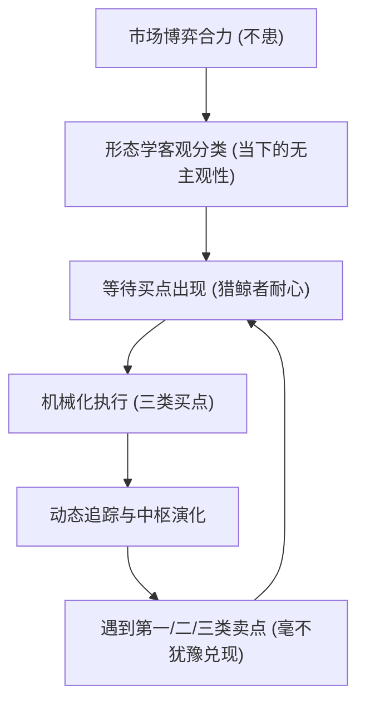
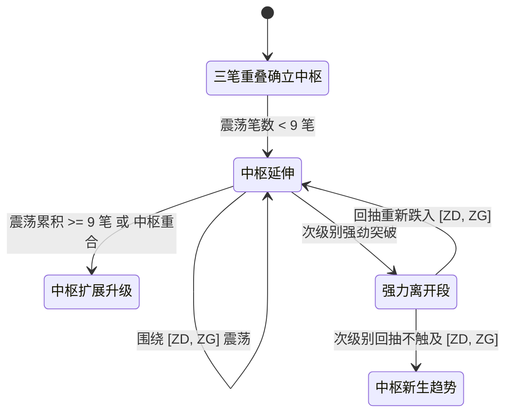

# 缠中说禅《教你炒股票108课》全景精要与量化工程架构指南

> **导言**：本文档基于缠中说禅（微信/博客名篇《教你炒股票108课》）全部 108 篇博文原文的核心表述与思想体系，严格保留缠师原本的哲学逻辑、几何形态学定义、动力学物理隐喻与博弈心法，对其进行全景式分类梳理，并构建其在现代量化交易算法中的精准映射与数学实现。

---

## 目录
1. [一、 缠论核心哲学与心法篇（第 1 ~ 11 课、第 79 ~ 87 课）](#一-缠论核心哲学与心法篇)
2. [二、 形态学体系：从几何分型到走势中枢（第 62 ~ 78 课）](#二-形态学体系从几何分型到走势中枢)
   - [2.1 K线包含关系与标准化处理](#21-k线包含关系与标准化处理)
   - [2.2 顶分型与底分型定义](#22-顶分型与底分型定义)
   - [2.3 笔的严格划分与判定](#23-笔的严格划分与判定)
   - [2.4 线段的划分与特征序列破坏](#24-线段的划分与特征序列破坏)
   - [2.5 走势中枢的数学公理与几何定义](#25-走势中枢的数学公理与几何定义)
3. [三、 动力学体系：背驰、MACD辅助与中枢演化（第 12 ~ 45 课）](#三-动力学体系背驰macd辅助与中枢演化)
   - [3.1 走势必完美公理与趋势/盘整划分](#31-走势必完美公理与趋势盘整划分)
   - [3.2 中枢延伸、扩展与新生](#32-中枢延伸扩展与新生)
   - [3.3 背驰判定：趋势背驰与盘整背驰](#33-背驰判定趋势背驰与盘整背驰)
   - [3.4 MACD 柱状图面积积分与动能对比](#34-macd-柱状图面积积分与动能对比)
4. [四、 博弈与操作篇：三类买卖点与资金管理（第 14 ~ 22 课、第 91 ~ 108 课）](#四-博弈与操作篇三类买卖点与资金管理)
   - [4.1 第一类买卖点（1B / 1S）：转折之王](#41-第一类买卖点1b--1s转折之王)
   - [4.2 第二类买卖点（2B / 2S）：回踩确认](#42-第二类买卖点2b--2s回踩确认)
   - [4.3 第三类买卖点（3B / 3S）：主升突破](#43-第三类买卖点3b--3s主升突破)
   - [4.4 区间套显微镜法则（多级别联立）](#44-区间套显微镜法则多级别联立)
   - [4.5 交易节奏与资金分配模型](#45-交易节奏与资金分配模型)
5. [五、 缠论在量化交易系统中的工程算法实现](#五-缠论在量化交易系统中的工程算法实现)

---

## 一、 缠论核心哲学与心法篇

缠论不仅仅是一套技术分析工具，其底层建立在严密的辩证法、拓扑几何学与现代博弈论之上。缠师在开篇即明确指出了市场投机的根本逻辑：

### 1.1 市场不患与患（本体论）
- **不患（绝对性）**：市场由所有参与者的合力构成，走势不可更改且当下呈现。**“买点买，卖点卖”**是唯一不患的真理。
- **患（相对性）**：价格波动的不可预测性与复杂性。交易者无需预测未来，只需根据当前走势的形态与动力学状态，做客观的分类与机械化应对。

### 1.2 节奏与欲望陷阱
- **“不会赢钱的经济人，只是废人！”**（第 1 课）：交易不是为了证明自己的聪明，而是为了赢利。凡是陷在自我预测和情绪幻觉中的人，终将被市场淘汰。
- **“没有节奏，只有死！”**（第 2 课）：市场如同交响乐，有其呼吸与脉动。追高杀跌本质上是踏错了节拍，在卖点冲动买入，在买点恐惧割肉。
- **“你的喜好，你的死亡陷阱！”**（第 3 课）：永远不要爱上一只股票，股票只是获利的工具（面首论）。买点出现，它就是最好的；卖点出现，毫不犹豫地抛弃。

### 1.3 猎鲸者的耐心
- 真正的交易者是孤独的猎人，80% 以上的时间是在等待。只有在猎物进入绝对合法的伏击圈（三类买卖点）时，才扣动扳机。



---

## 二、 形态学体系：从几何分型到走势中枢

形态学是缠论的几何骨架。它从原始散乱的报价序列出发，通过纯递归的方式，将无序的 K 线抽象为严格的拓扑结构。

### 2.1 K线包含关系与标准化处理
相邻两根 K 线，如果一根的范围完全覆盖另一根（即 $High_1 \ge High_2$ 且 $Low_1 \le Low_2$，或者反之），称为**包含关系**。

```
[向上处理: 取高高、低低]             [向下处理: 取低高、低低]
   |                                    |
+-----+                              +-----+
|  2  |   =>   +-----+               |  1  |   =>   +-----+
+-----+        |     |               +-----+        |     |
+-----+        | 合并|               +-----+        | 合并|
|  1  |        |     |               |  2  |        |     |
+-----+        +-----+               +-----+        +-----+
   |              |                     |              |
```

- **方向确定准则**：在当前包含关系出现前，最近两根**非包含关系** K 线的方向决定合并方向：
  - 若前一状态为上升（$H_n > H_{n-1}$ 且 $L_n > L_{n-1}$），则采用**向上合并**：
    $$\begin{cases} High_{merge} = \max(High_n, High_{n+1}) \\ Low_{merge} = \max(Low_n, Low_{n+1}) \end{cases}$$
  - 若前一状态为下降（$H_n < H_{n-1}$ 且 $L_n < L_{n-1}$），则采用**向下合并**：
    $$\begin{cases} High_{merge} = \min(High_n, High_{n+1}) \\ Low_{merge} = \min(Low_n, Low_{n+1}) \end{cases}$$

### 2.2 顶分型与底分型定义
经过包含关系完全标准化处理后的连续 3 根 K 线：

```
       [顶分型 (Top Fractal)]                   [底分型 (Bottom Fractal)]
                +---+                                    +---+
                | 2 | (最高点)                           | 1 |
                +---+                           +---+    +---+
          +---+   |   +---+                     | 3 |      |
          | 1 |   |   | 3 |                     +---+      |
          +---+   |   +---+                       |      +---+
            |     |     |                         |      | 2 | (最低点)
                                                         +---+
```

- **顶分型**：中间 K 线的高点是三根中最高，低点也是三根中最高（转折向下信号）。
- **底分型**：中间 K 线的低点是三根中最低，高点也是三根中最低（转折向上信号）。

### 2.3 笔的严格划分与判定
- **笔的要素**：由一个顶分型和一个底分型通过直线连接构成。
- **严格笔的充要条件**：
  1. 顶分型和底分型必须交替出现；
  2. 顶分型的高点必须高于底分型的低点（$High_{top} > Low_{bottom}$）；
  3. 顶分型和底分型之间，**必须至少有一根不属于任何分型的独立合并 K 线**。也就是说，从顶分型最高 K 线到底分型最低 K 线之间，至少包含 5 根连续标准 K 线。

```
顶分型最高点
     *
    / \
   /   \  <- 中间至少间隔独立 K 线 (无未来函数严格确认)
  /     \
 /       * 底分型最低点
[一笔成立]
```

### 2.4 线段的划分与特征序列破坏
- 一个线段至少由连续的**三笔**构成，且前三笔必须存在重叠区间。
- 向上线段由向上笔开始，以向下笔破坏；向下线段由向下笔开始，以向上笔破坏。
- 线段的破坏通过**特征序列分型**严格确认，有效滤除次级别的虚假杂波震荡。

### 2.5 走势中枢的数学公理与几何定义
走势中枢是缠论动力学的核心力场。

- **定义**：某级别走势类型中，被至少连续三个次级别走势类型（或在严格算法中被连续三笔）所重叠的价格区间。
- 设前三笔分别为 $S_1, S_2, S_3$，各自的高低点为 $[L_1, H_1], [L_2, H_2], [L_3, H_3]$：
  - 中枢上沿 $ZG$（ZhongShu High）：前三笔高点的最小值
    $$ZG = \min(H_1, H_2, H_3)$$
  - 中枢下沿 $ZD$（ZhongShu Low）：前三笔低点的最大值
    $$ZD = \max(L_1, L_2, L_3)$$
  - **中枢有效性条件**：$ZG \ge ZD$。有效中枢区间为 $[ZD, ZG]$。
  - 中枢极值波动范围：
    $$GG = \max(H_1, H_2, H_3), \quad DD = \min(L_1, L_2, L_3)$$

```
价格
 ^
 |             H1               H3
 |             /\               /\
 |            /  \     H2      /  \
 |-----------/----\----/\-----/----\----  ZG = min(H1, H2, H3)  [中枢上轨]
 |          /      \  /  \   /      \
 |         /        \/    \ /        \
 |--------/---------/------V----------\-- ZD = max(L1, L2, L3)  [中枢下轨]
 |       /         L1     L2           \
 |      /                               \
 +-----------------------------------------> 时间
```

---

## 三、 动力学体系：背驰、MACD辅助与中枢演化

### 3.1 走势必完美公理与趋势/盘整划分
- **走势必完美**：任何级别的任何走势类型，都必然包含至少一个该级别的走势中枢并最终完成。
- **盘整**：某级别完成的走势类型中，只包含**一个**该级别的走势中枢。
- **趋势**：某级别完成的走势类型中，包含**两个以上同方向**且区间互不重叠的该级别走势中枢。

### 3.2 中枢延伸、扩展与新生
1. **中枢延伸**：后续围绕该中枢的震荡笔数小于 9 笔。
2. **中枢扩展（级别升级）**：围绕该中枢的震荡达到或超过 9 笔，或者两个同级别中枢产生波动区间交叉，中枢自动合并升级为更高一级别的中枢。
3. **中枢新生（形成趋势）**：脱离中枢的走势产生次级别回抽，且回抽不接触原中枢区间，在同方向形成新中枢。



### 3.3 背驰判定：趋势背驰与盘整背驰
背驰是多空博弈动能衰竭的数学反映，是转折的物理充要条件。
- **趋势背驰**：标准形态为 $a + A + b + B + c$（其中 $A, B$ 为同向两个中枢），$c$ 段创新高/新低，但 $c$ 段的力度与动能明显弱于 $b$ 段。
- **盘整背驰**：离开中枢的段落 $c$ 相比进入中枢的段落 $a$，力度出现衰竭。

### 3.4 MACD 柱状图面积积分与动能对比
由于实际行情中无法直接观测不可见的能量，缠师提出了使用 MACD 作为动力学辅助透视仪：
- **面积积分法**：
  $$\text{Energy} = \int_{t_0}^{t_1} |\text{MACD\_HIST}(t)| \, dt$$
  当价格创新高/新低，但对应区间的红/绿柱面积明显萎缩，且 DIF/DEA 峰值不创新高/低时，发生标准背驰。

```
价格曲线:
 P2 (更高的新高)   /\
                  /  \
 P1              /    \
  /\            /      \
 /  \__________/        \

MACD 柱线积分 (动能明显衰竭背驰):
   /\
  /  \  <- 面积 S1
 /____\
              /\
             /  \ <- 面积 S2 < S1 (背驰形成!)
            /____\
```

---

## 四、 博弈与操作篇：三类买卖点与资金管理

缠论在交易上的最伟大贡献，在于证明了**任何市场的任何转折，都必然由且仅由三类买卖点囊括**。

| 买卖点分类 | 出现位置与特征 | 策略风格与盈亏比 | 缠师原著名篇定性 |
| :--- | :--- | :--- | :--- |
| **第一类买点 (1B)** | 下跌趋势中第二个中枢后的底背驰终结点 | 左侧抄底、极低回撤、盈亏比最大 (1:3 以上) | “背驰制造买点，安全度最高” |
| **第二类买点 (2B)** | 1B 之后第一波次级别反弹后的次回踩，不破 1B 最低点 | 右侧确认、形态企稳、成功率极高 | “1B 的孪生兄弟，不破低点的确认” |
| **第三类买点 (3B)** | 强劲脱离中枢后，次级别回抽其低点不跌破中枢上沿 $ZG$ | 追随主升浪、爆发力极强、资金效率最高 | “世界第一等买点，牛市主升浪启动机” |

```
价格
 ^                                                    (主升浪飞升)
 |                                                         /
 |                                         * 3B (第三类买点)
 |                      突破段            / \   回抽不跌入 ZG!
 |                      ----------------/----\---------------- ZG
 |                     /   [走势中枢]   /      \
 |       反弹段       /                /        \
 |         /\        /                /          \
 |        /  \      /                /            \
 |       /    \    /                 \             ---------------- ZD
 |      /      * 2B (第二类买点: 回踩不破 1B)
 |     /
 |    /
 |   * 1B (第一类买点: 下跌趋势背驰底)
 +------------------------------------------------------------------------> 时间
```

### 4.1 第一类买卖点（1B / 1S）：转折之王
- **买点条件**：某级别下跌趋势经过至少两个中枢，且第二中枢后的离开段与前一段产生显著 MACD 绿柱面积背驰，随后产生底分型确认。
- **止损逻辑**：跌破 1B 最低价立即止损。

### 4.2 第二类买卖点（2B / 2S）：回踩确认
- **买点条件**：在 1B 之后出现次级别向上走势，随后的次级别向下走势未跌破 1B 的最低点，并在此企稳形成底分型。
- **操作意义**：对于不敢抄底 1B 的右侧交易者，2B 是最安全、最具确定性的入场点。

### 4.3 第三类买卖点（3B / 3S）：主升突破
- **买点条件**：某级别中枢向上离开后，随后的次级别回调低点 $Low_{pullback} > ZG$。
- **操作意义**：宣告中枢震荡彻底结束，新趋势诞生。这是牛市捕捉强势妖股和指数主升浪的终极买点。

### 4.4 区间套显微镜法则（多级别联立）
- **显微镜定理**：在大级别（如日线）锁定 1B 出现的潜在大区间后，切换到次级别（30 分钟），再切换到次次级别（5 分钟），利用级别之间的自相似性，逐层寻找背驰重叠点，从而实现“在精准针尖上买入”的惊人精度。

### 4.5 交易节奏与资金分配模型
- **分仓律**：1B 建仓 30% 基石仓位，2B 确认时加仓 40%，3B 突破确立时满仓 30% 浮盈加速。
- **动态止盈防守**：跌破前一笔低点或遭遇次级别 1S 减半，遭遇本级别 1S 或 2S 全部清仓。

---

## 五、 缠论在量化交易系统中的工程算法实现

为消除主观“千人千缠”的弊端，我们将缠论 108 课转化为**严格、严谨、无未来函数**的工业级量化算法：

```
+-----------------------------------------------------------------------+
|                       原始行情数据 (OHLCV DataFrame)                   |
+-----------------------------------------------------------------------+
                                   |
                                   v
+-----------------------------------------------------------------------+
|  步骤 1: K线包含关系严格过滤 (Merge Inclusions)                       |
|  - 前置方向追踪 (上升/下降)                                            |
|  - 动态合并高低点 (完全无未来函数)                                    |
+-----------------------------------------------------------------------+
                                   |
                                   v
+-----------------------------------------------------------------------+
|  步骤 2: 顶分型与底分型提取 (Identify Fractals)                        |
|  - 严格三K线形态对比                                                  |
|  - 记录分型极值与所在原始 K 线时间戳                                  |
+-----------------------------------------------------------------------+
                                   |
                                   v
+-----------------------------------------------------------------------+
|  步骤 3: 严格标准化笔划分 (Construct Standard Bis)                    |
|  - 顶底交替约束                                                       |
|  - 顶底间独立合并 K 线数 >= 1 笔规则约束                              |
+-----------------------------------------------------------------------+
                                   |
                                   v
+-----------------------------------------------------------------------+
|  步骤 4: 走势中枢计算与状态追踪 (Compute ZhongShu & Pivots)           |
|  - 前三笔交集: ZG = min(H1,H2,H3), ZD = max(L1,L2,L3)                 |
|  - 记录中枢震荡极值 [DD, GG] 与延伸段数                              |
+-----------------------------------------------------------------------+
                                   |
                                   v
+-----------------------------------------------------------------------+
|  步骤 5: 动力学背驰与买卖点标记 (Detect Divergence & Signals)          |
|  - MACD 面积积分与绝对峰值衰减检测                                    |
|  - 1B: 趋势背驰最低转折点                                             |
|  - 2B: 回踩企稳不破 1B 最低点                                         |
|  - 3B: 次级别回抽不破中枢上轨 ZG                                      |
+-----------------------------------------------------------------------+
```

此算法构架完全封装于 `core/chan_theory.py` 与 `strategies/chan_strategy.py` 中，并已深度链接至交易决策大盘与买点预测看板。
